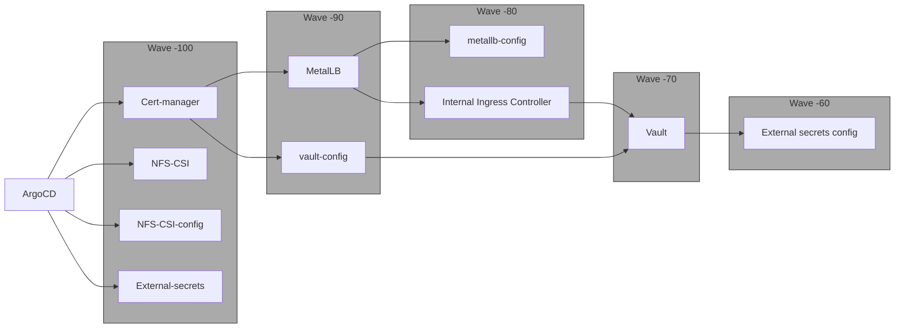

# PodHub: Talos Kubernetes Cluster on Bare-Metal

Terraform project that provisions a **Talos Linux Kubernetes cluster**, installs Cilium as CNI, and deploys ArgoCD. Uses:

- Sidero Labs Talos provider (`talos`)
- Helm provider (`helm`)
- Kubernetes provider (`kubernetes`)
- ArgoCD provider (`argocd`)

---

## Quick Start

1. Edit `terraform.tfvars` (nodes + versions)
2. Run `terraform init && terraform apply` (add `-var write_talosconfig=true` if you want `./talosconfig` written; the flag defaults to `false`)
3. Generate the kubeconfig on demand:

```bash
export TALOSCONFIG=$PWD/talosconfig      # or: cp talosconfig ~/.talos/config
talosctl --talosconfig ./talosconfig -n 10.10.20.11 kubeconfig > kubeconfig
export KUBECONFIG=$PWD/kubeconfig
```

**The first bootstrap may need a second `terraform apply`.** `talos_cluster` completes
as soon as the Talos layer is healthy (etcd/apid/kubelet), which can be before
kube-apiserver and the Layer2 VIP are serving. The first Kubernetes API call (the
node inventory used by the health gate) can therefore fail with
`dial tcp <vip>:6443: connect: connection refused`. Re-running `apply` continues from
there — there is deliberately no sleep or `local-exec` workaround. This is tracked in
[siderolabs/terraform-provider-talos#221](https://github.com/siderolabs/terraform-provider-talos/issues/221);
a control-plane-only health mode will remove both the inventory and the second apply.
See [Client configs](#client-configs) for how to get/regenerate the configs.

---

## Architecture

The project is **phase-separated** and uses **programmatic decision-making** via Terraform locals instead of repetitive resource blocks.

### File Structure

| File                | Phase            | Responsibility                                                                                                                                          |
| :------------------ | :--------------- | :------------------------------------------------------------------------------------------------------------------------------------------------------ |
| `0-terraform.tf`    | Base             | `terraform {}` block + `required_providers`.                                                                                                            |
| `0-variables.tf`    | Base             | Input variable definitions (`var.nodes`, versions, endpoint).                                                                                           |
| `1-factory.tf`      | **Info Phase**   | Image Factory API lookups + schematic definitions (per architecture × role).                                                                            |
| `1-certs-cilium.tf` | **Info Phase**   | TLS CA + certificates for Cilium Hubble. No cluster dependencies.                                                                                       |
| `1-cluster-info.tf` | **Info Phase**   | Secrets + machine config data source (for outputs) and ephemeral variant (for `talos_machine`) + **patch composition logic in locals**.                 |
| `2-cluster.tf`      | **Action Phase** | `talos_machine.all`, `talos_cluster.this` (bootstrap), ephemeral admin kubeconfig, health gate. Defines `local.kubernetes_client_config` for providers. |
| `3-cilium.tf`       | **Apps Phase**   | Helm release for Cilium CNI. Depends on the Talos health gate.                                                                                          |
| `3-secrets.tf`      | **Apps Phase**   | Kubernetes namespaces and secrets (Vault, External Secrets).                                                                                            |
| `4-argocd.tf`       | **Apps Phase**   | Helm release for ArgoCD + `data.kubernetes_secret_v1.argocd_admin`.                                                                                     |
| `9-outputs.tf`      | Last             | Outputs (talosconfig, node configs, secrets yaml) + writes `./talosconfig` (flag `write_talosconfig`).                                                  |
| `terraform.tfvars`  | -                | User-provided values (`var.nodes`, versions, endpoint).                                                                                                 |

---

## Node Configuration

All nodes live in one map, `var.nodes`. Each entry:

```hcl
nodes = {
  "10.10.20.21" = {
    role         = "worker"        # "controlplane" or "worker"
    architecture = "arm64_rpi"    # arm64_rpi | arm64_generic | x86_intel | x86_nvidia
    disk         = "/dev/mmcblk0" # install disk selector (dev_path)
    hostname     = "abysmal-underling-1"
    manual       = false          # true = render config only, never touch the node
    labels = {
      "topology.kubernetes.io/region" = "ESP"
      "topology.kubernetes.io/zone"   = "Barcelona"
    }
    taints = {}                   # workers only, e.g. { "region" = "ARG:NoSchedule" }
  }
}
```

| Attribute      | Determines                                                                                                                                                                                                       |
| :------------- | :--------------------------------------------------------------------------------------------------------------------------------------------------------------------------------------------------------------- |
| `role`         | Machine type; control planes get the extra patches (admission control, no flannel, no kube-proxy, etcd metrics, Layer2 VIP).                                                                                     |
| `architecture` | Image Factory schematic (`<architecture>-<role>`), which selects extensions and overlay (RPi).                                                                                                                   |
| `hostname`     | Talos hostname **and** the Kubernetes Node name. Used to correlate nodes with the Kubernetes API (see health gates).                                                                                             |
| `manual`       | Excludes the node from `talos_machine` (no apply/bootstrap/health gating). Its config is exposed via `terraform output manual_configs` for manual `talosctl apply-config`.                                       |
| `protected`    | Hard guarantee: requires `manual = true`, and defensively keeps the node out of `talos_machine` even if `manual` is accidentally dropped. Terraform will never apply config to it, reset/wipe it, or destroy it. |
| `labels`       | `KubeNodeConfig` labels.                                                                                                                                                                                         |
| `taints`       | `KubeNodeConfig` taints, workers only.                                                                                                                                                                           |

### Protected nodes (the ARG machines)

The two `192.168.0.100` / `192.168.1.5` workers are installed in Argentina, reachable
only over KubeSpan, and **have no physical access for reprovisioning**. They are
declared with `manual = true` **and** `protected = true`, which means:

- Terraform never applies config to them, never resets/wipes them, and never destroys
  them — `terraform destroy` only touches the auto-provisioned ESP nodes;
- they are excluded from the health gate, so they can never block an apply;
- removing their entry from `var.nodes` only stops rendering their config; the
  machines keep running and stay in the cluster.

They rejoin a rebuilt cluster over KubeSpan as long as the cluster identity (the
`talos_machine_secrets`, i.e. `secrets.yaml`) is the same. **Never run `talosctl
reset` against them**, and keep a copy of `secrets.yaml` outside Terraform (see
[Destroy and rebuild](#destroy-and-rebuild)).

### Configuration patches and templates

| File                                           | Applied to             | Purpose                                                                                                                          |
| :--------------------------------------------- | :--------------------- | :------------------------------------------------------------------------------------------------------------------------------- |
| `patches/KubeSpanConfig.yaml`                  | all nodes              | KubeSpan mesh (also used for the protected ARG nodes).                                                                           |
| `patches/RegistryMirrorConfig.yaml`            | auto-provisioned nodes | Registry mirrors (manual/ARG nodes cannot reach the local mirror).                                                               |
| `patches/KubeAdmissionControlConfig.yaml`      | control planes         | PodSecurity: explicit `defaults.enforce: privileged` (generated default is `baseline`).                                          |
| `patches/KubeFlannelCNIConfig.yaml`            | control planes         | Deletes flannel; Cilium is the CNI.                                                                                              |
| `patches/KubeProxyConfig.yaml`                 | control planes         | Disables kube-proxy; Cilium replaces it.                                                                                         |
| `patches/etcdMetrics.yaml`                     | control planes         | etcd `listen-metrics-urls`. As of Talos 1.14 there is **no** etcd extraArgs document, so this stays in the `cluster.etcd` block. |
| `templates/HostnameConfig.yaml.tftpl`          | every node             | Static hostname (also the Kubernetes Node name).                                                                                 |
| `templates/KubeNodeConfig.yaml.tftpl`          | every node             | Node labels/taints (replaces the deprecated `machine.nodeLabels` / `machine.nodeTaints`).                                        |
| `templates/Layer2VIPConfig.yaml.tftpl`         | control planes         | API VIP; `link` is required in the 1.14 schema.                                                                                  |
| `templates/UnattendedInstallConfig.yaml.tftpl` | every node             | Installer image and disk (replaces the deprecated `machine.install`; overrides the provider default `/dev/sda`).                 |

---

## Version Management

There are **three independent version knobs**, and they should not be bumped together:

| Variable                  | What it controls                                                                                                                  | When to bump                                                      |
| :------------------------ | :-------------------------------------------------------------------------------------------------------------------------------- | :---------------------------------------------------------------- |
| `talos_version`           | Machine-config **contract** (`talos_machine_configuration` + `talos_machine_secrets`). Defines schema/defaults of generated YAML. | Almost never. Pin it to the version the cluster was created with. |
| `talos_installer_version` | Installed Talos OS (`talos_machine.image`, Image Factory lookups).                                                                | Every Talos OS upgrade (patch or minor).                          |
| `kubernetes_version`      | Components bootstrapped by Talos and driven by `talos_cluster` (`upgrade-k8s`).                                                   | Every Kubernetes upgrade.                                         |

This is exactly what the provider recommends: `talos_machine_configuration.talos_version` is a
config-generation contract, **not** the installed version; `image` is what upgrades.

Support matrix: Talos 1.14 supports Kubernetes **1.33 – 1.37**. Check
<https://docs.siderolabs.com/talos/v1.14/getting-started/support-matrix> before bumping.

### Talos OS upgrade

```bash
# 1. Bump talos_installer_version ONLY (leave talos_version alone).
# 2. Plan. If an Image Factory extension is not published for the target
#    release, the plan fails here — before anything reboots. That is the gate.
terraform plan

# 3. Apply sequentially. Default parallelism is 10 and would reboot all three
#    control planes at once (etcd quorum loss).
terraform apply -parallelism=1
```

For maximum control (and to verify each node before continuing):

```bash
terraform apply -target='talos_machine.all["10.10.20.13"]'
talosctl -n 10.10.20.13 version          # node is back on the new version
terraform apply -target='talos_machine.all["10.10.20.12"]'
# ... then .11, then the workers
terraform apply                          # converge the rest
```

Notes:

- **Nodes are drained automatically** before the upgrade reboot (`drain_on_upgrade`
  defaults to `true`): cordon → drain → upgrade/reboot → wait for the node →
  uncordon. It only triggers on an image change, never on config-only updates.
- Because of that, `-parallelism=1` is not just about etcd: with the default
  parallelism every node would be drained at the same time, and a
  `PodDisruptionBudget` or a single-replica workload could deadlock the upgrade.
  Check `kubectl get pdb -A` before a fleet upgrade.
- If the Kubernetes API is unavailable and Talos still needs upgrading, bypass the
  drain with `terraform apply -parallelism=1 -var drain_on_upgrade=false`.
- `talos_machine_secrets.talos_version` follows the contract and does **not** rotate
  certificates when changed.
- Patch upgrades do not require touching `talos_version`. A **minor** upgrade
  (1.14 → 1.15) is two separate applies: first the installer version, then the
  contract (which regenerates every machine config).

### Kubernetes upgrade

```bash
# 1. Bump kubernetes_version (keep Talos versions untouched).
# 2. Optional dry run against a control plane:
talosctl -n 10.10.20.11 upgrade-k8s --to v1.37.1 --dry-run
# 3. Apply. talos_cluster.kubernetes_version drives upgrade-k8s:
#    pre-pull images, static pods one by one with health gating, kube-proxy,
#    kubelet sequentially.
terraform apply
```

`ignore_kubernetes_upgrade_drift = true` on `talos_machine` is what makes this safe: it
stops `talos_machine` from re-applying the five Kubernetes component image fields in
parallel, leaving `upgrade-k8s` fully in charge.

A version bump therefore produces **a single in-place change (`talos_cluster`)**.
`talos_machine` receives its config through the write-only `machine_configuration_wo`
argument (fed by the ephemeral `talos_machine_configuration`), so the regenerated YAML
— which only differs in component image tags — never shows up as an update per node.
Drift detection is unchanged: it goes through the normalized `machine_configuration_hash`.

> One-time migration: if your state still has `machine_configuration`, the first apply
> after upgrading this module shows `- machine_configuration = (sensitive) -> null` on
> each machine. That is a state-only change; the provider skips the config apply
> because the normalized hash is unchanged, so no node is touched. Every plan after
> that is clean.

Notes:

- Never bump Talos and Kubernetes in the same apply.
- Image pre-pull goes through the registry mirrors in `patches/RegistryMirrorConfig.yaml`;
  make sure the mirror is reachable before upgrading.
- kube-proxy is disabled (Cilium replaces it); `upgrade-k8s` handles the absent
  DaemonSet, but do a `--dry-run` once per Talos minor to confirm.

---

## Scaling

### What the health gate actually checks

There is exactly **one** gate, `ephemeral.talos_cluster_health.talos` in
`2-cluster.tf`. It runs the Talos-layer checks (etcd, apid, kubelet, boot sequence)
against the control planes that are **currently registered in Kubernetes and Ready**
(`data.kubernetes_nodes`, filtered by the `node-role.kubernetes.io/control-plane`
label). The list comes from the cluster, not from `var.nodes`:

- a control plane being **added** is not registered yet → it is not waited for at
  plan time, so scale-up no longer deadlocks;
- a control plane being **removed** is still registered (and still an etcd member) →
  it stays in the list, so the plan passes and `on_destroy.graceful` lets it leave
  etcd during the apply;
- workers are never part of the list, so `manual = true` nodes (the remote ARG
  machines) cannot block an apply;
- a **down** control plane is excluded, so the gate fails fast with an etcd
  member-mismatch error instead of hanging for 15 minutes.

The gate runs on every `plan` and `apply` (that is how ephemeral resources work), so
a plan needs a reachable API — which it already needed for the
`kubernetes_secret_v1.argocd_admin` data source.

**Emergency escape hatch.** If the control plane/etcd is broken (a dead control plane
still listed as an etcd member, no leader, etc.) the gate will fail and block even a
`destroy`. Set `healthcheck_enabled = false` to skip the gate _and_ the Kubernetes
node inventory:

```bash
terraform destroy -var healthcheck_enabled=false
```

It mutates nothing by itself; leave it at the default (`true`) for normal runs.

> **Why there is no "kubernetes" health gate anymore.** Talos's
> `DefaultClusterChecks()` asserts that the expected node set matches the cluster
> _exactly_ (`K8sAllNodesReportedAssertion`): leaving workers out fails with
> `unexpected nodes with IPs [...]`, and listing a node that has not been created
> yet blocks until the timeout. There is no partial list that works, and listing the
> manual/remote workers would let them gate every apply. API readiness is covered by
> the Cilium Helm release (it talks to the API and waits for the DaemonSet), and
> `talos_cluster` runs the Talos checks on create.

### Verify the whole cluster after an apply (CI)

`talosctl health` uses the same checks and must list **every** node in the cluster,
otherwise the "unexpected nodes" assertion fails. Run it after the apply, not as a
Terraform gate:

```bash
talosctl -n 10.10.20.11 health \
    --control-plane-nodes 10.10.20.11,10.10.20.12,10.10.20.13 \
    --worker-nodes 10.10.20.21,10.10.20.22,192.168.0.100,192.168.1.5 \
    --wait-timeout 15m
```

### Add a worker

1. Add the entry to `var.nodes`.
2. `terraform apply`. The health gate checks only existing control planes.
3. Verify: `kubectl get nodes -o wide`.

### Add a control plane

1. Add the entry with `role = "controlplane"`.
2. `terraform apply` (Talos joins etcd automatically when the config is applied).
3. Verify: `talosctl -n <any-cp> etcd member list` should show the new member.

Add one control plane at a time.

### Remove a worker

```bash
kubectl drain <node> --ignore-daemonsets --delete-emptydir-data
# remove the entry from var.nodes, then:
terraform apply
kubectl delete node <node>   # if the Node object lingers
```

`talos_machine` destroys the node (`on_destroy`: reset + reboot), which **wipes the
disk**. If you only want to retire the hardware temporarily, set `manual = true`
instead of removing the entry.

`manual`/`protected` nodes have no `talos_machine`, so removing their entry from
`var.nodes` does **nothing** to the running machine. To take one out of the cluster
you must drain it and delete its Node object by hand; never reset a `protected` node.

### Remove a control plane

Do it one node at a time, and never below 3 control planes unless you accept the
reduced quorum tolerance (3 → 2 means any single failure loses quorum).

Control-plane `talos_machine` resources use `on_destroy.graceful = false` (see
[Destroy and rebuild](#destroy-and-rebuild) for the reason), so the reset does **not**
drain the node and does **not** remove its etcd member. Do both explicitly:

```bash
# 1. Drain the workload side first (the reset will not do it).
kubectl drain <hostname> --ignore-daemonsets --delete-emptydir-data

# 2. Remove the entry from var.nodes and let Terraform reset+wipe the node.
terraform apply

# 3. Remove the now-stale etcd member while quorum still exists.
talosctl -n <surviving-cp> etcd members
talosctl -n <surviving-cp> etcd remove-member <member-id>

# 4. Remove the leftover Node object.
kubectl delete node <hostname>
```

Order matters: remove the member **after** the node is wiped, so the leave cannot
succeed on its own and no quorum is lost while it is still a member.

---

## Destroy and rebuild

`terraform destroy` tears down Helm/namespaces first, then `talos_cluster` (its Delete
is a no-op), then each `talos_machine` with a **reset + wipe + reboot**.

- **Only auto-provisioned nodes are wiped.** The `manual`/`protected` ARG nodes have
  no `talos_machine`, so they are never touched, never reset, and never left in
  maintenance mode. They keep their credentials and rejoin the new cluster over
  KubeSpan once it is up with the same identity.
- **Why control planes use `graceful = false`.** In Talos's reset sequence only the
  drain and cleanup phases are best-effort (`logError`). The etcd `leave` phase is
  **fatal**: if it fails, the whole reset aborts and the node is not wiped. The last
  remaining etcd member can never leave its own cluster, so a graceful reset of the
  final control plane is impossible — it would leave `terraform destroy` stuck with a
  half-wiped cluster. Workers have no etcd membership, so they keep `graceful = true`
  (drain only, best-effort).
- **Broken cluster:** if the control plane is unhealthy the health gate will block the
  destroy; use the escape hatch:

  ```bash
  terraform destroy -var healthcheck_enabled=false
  ```

  If the Kubernetes API is completely unreachable, the Helm releases cannot be
  uninstalled either — remove them from state first:

  ```bash
  terraform state rm helm_release.cilium helm_release.argocd
  terraform destroy -var healthcheck_enabled=false
  ```

- **The talosconfig file is removed too.** `terraform destroy` deletes
  `./talosconfig` (it contains admin credentials for a cluster that no longer
  exists). The kubeconfig is not managed by Terraform, so delete it yourself if you
  want. `secrets.yaml` is not touched — see the next point.
- **Keep the cluster identity if you want the ARG nodes back.** `terraform destroy`
  destroys `talos_machine_secrets` too, so save the secrets _before_ destroying and
  re-import them when you rebuild:

  ```bash
  terraform output -raw talos_secrets_yaml > secrets.yaml   # keep this file safe
  terraform destroy

  ./import-secrets.sh secrets.yaml v1.14.1                  # same CA/tokens
  terraform apply                                           # ARG nodes rejoin
  ```

---

## Cheat Sheet

### Reset auto-provisioned nodes to maintenance mode

> **DANGER:** list the nodes explicitly. Never reset `192.168.0.100` /
> `192.168.1.5` — they have no physical access and would stay in maintenance mode
> forever. Do not derive this list from `kubectl get nodes`; that includes them.

```bash
talosctl reset \
    --system-labels-to-wipe STATE \
    --system-labels-to-wipe EPHEMERAL \
    --reboot=true \
    --graceful=false \
    -n 10.10.20.11,10.10.20.12,10.10.20.13,10.10.20.21,10.10.20.22
```

### The ARG nodes

There is intentionally no reset command here. `192.168.0.100` and `192.168.1.5` are
`protected`: no physical access, no reprovisioning. They reconnect through KubeSpan
with the same cluster secrets and must never be reset or left in maintenance mode.

### Delete all resources from Terraform's state

```bash
terraform state rm $(terraform state list)
```

### Client configs

**talosconfig** — opt-in: with `-var write_talosconfig=true` it is written to
`./talosconfig` (0600) on apply by a `local_sensitive_file` resource and removed by
`terraform destroy` (default `false`). It is also a regular Terraform output:

```bash
terraform output -raw talosconfig > talosconfig
```

**kubeconfig** — not generated by Terraform. It is issued by the cluster; internally
it is an ephemeral value (used by the providers and the drain logic, never stored in
state), and Terraform forbids ephemeral outputs in a root module. Generate it on
demand once the cluster is up:

```bash
talosctl --talosconfig ./talosconfig -n 10.10.20.11 kubeconfig > kubeconfig
export KUBECONFIG=$PWD/kubeconfig      # or: cp kubeconfig ~/.kube/config
```

**After `terraform destroy` / with empty state** there is no cluster to read a
kubeconfig from, and the `talosconfig` output is gone with the state. Recreate the
talosconfig from the cluster identity in `secrets.yaml` — the OS CA is unchanged, so
the new client certificate works against a rebuilt cluster:

```bash
mkdir -p /tmp/talosgen
talosctl gen config PodHub https://10.10.20.15:6443 \
    --with-secrets secrets.yaml --output-dir /tmp/talosgen
cp /tmp/talosgen/talosconfig ./talosconfig
```

If you kept the previous `./talosconfig`, it remains valid for a rebuild that uses
the same `secrets.yaml`. A kubeconfig requires a running API server, so it can only
be generated once the new cluster is up.

### Get secrets

```bash
terraform output -raw talos_secrets_yaml | yq -y > tfsecrets.yaml
```

### Get node configs

```bash
terraform output -json controlplane_configs | jq -r '.[]'
terraform output -json worker_configs | jq -r '.[]'
terraform output -json manual_configs | jq -r '."192.168.0.100"'
```

### Apply a config to a manual node

```bash
terraform output -json manual_configs | jq -r '."192.168.0.100"' > /tmp/machine.yaml
talosctl apply-config -n 192.168.0.100 --file /tmp/machine.yaml
```

### Check the cluster health manually

List **all** nodes (control planes _and_ workers), otherwise the `K8sAllNodesReported`
assertion reports the missing ones as unexpected:

```bash
talosctl -n 10.10.20.11 health \
    --control-plane-nodes 10.10.20.11,10.10.20.12,10.10.20.13 \
    --worker-nodes 10.10.20.21,10.10.20.22,192.168.0.100,192.168.1.5 \
    --wait-timeout 15m
```

### Cleanup Cilium connectivity tests

```bash
kubectl delete ns cilium-test-ccnp1 cilium-test-ccnp2 cilium-test-1
```

### Debug pods

```yaml
apiVersion: v1
kind: Pod
metadata:
  name: netshoot-esp
spec:
  terminationGracePeriodSeconds: 0
  containers:
    - name: netshoot
      image: nicolaka/netshoot
      command: ["sleep", "infinity"]
---
apiVersion: v1
kind: Pod
metadata:
  name: netshoot-rosario
spec:
  nodeSelector:
    topology.kubernetes.io/region: ARG
    topology.kubernetes.io/zone: Rosario
  tolerations:
    - key: "region"
      operator: "Equal"
      value: "ARG"
      effect: "NoSchedule"
  terminationGracePeriodSeconds: 0
  containers:
    - name: netshoot
      image: nicolaka/netshoot
      command: ["sleep", "infinity"]
```

---

## Argo Sync Waves Planification



---

## Extending

### Add a new node

Just add an entry to `var.nodes` in `terraform.tfvars`. Nothing else.

### Add a new architecture

1. In `1-factory.tf`, add the extension list to `local.arch_extensions` (and an
   overlay to `local.arch_overlays` if the board needs one).
2. Use `architecture = "<new-arch>"` in your node definitions.

The `<architecture>-<role>` schematic is generated automatically.

### Change which static patches apply per role

Edit `local.static_patches_by_role` in `1-cluster-info.tf`. One place, not repeated.

---

## ToDo

- Dynamically get the link name for the VIP configuration.
